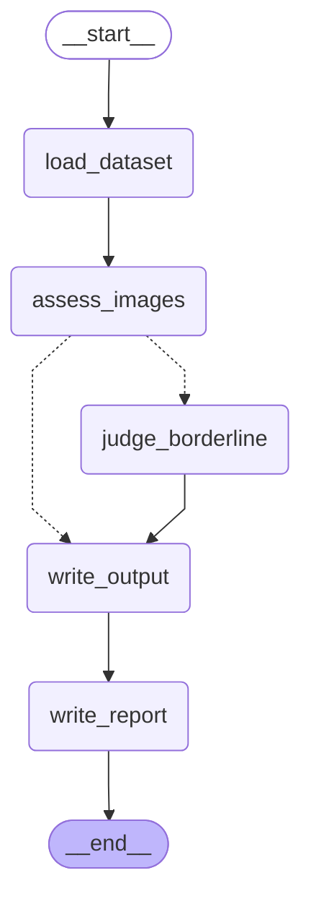

# cleanup

LangGraph pipeline that filters low-quality images out of a YOLO dataset before training
(RF-DETR / YOLO). Source data is never modified. Passing items are copied to a clean output dir.

```
load_dataset -> assess_images -> [judge_borderline] -> write_output -> write_report
```

- **assess_images**: deterministic checks (unreadable, resolution, exposure, blur via Laplacian
  variance, YOLO label validity).
- **judge_borderline**: only runs when some image is borderline (blur just above threshold).
  Pluggable `Judge`. Default applies `borderline_policy`. Optional free local VLM judge via
  Ollama (`--judge-model`). With `--judge-scope survivors` the VLM also reviews every image that
  passed the cheap checks.

## Dataset layout

```
data/raw/
  images/{train,val}/*.jpg
  labels/{train,val}/*.txt   # class cx cy w h (normalized)
```

## Usage

```bash
make install
make dry-run DATA=data/raw          # report only -> data/clean/report.json
make run DATA=data/raw OUT=data/clean
make stats
make check                          # lint + typecheck + tests
```

## VLM judge: Claude or local Ollama

`--judge-model` (and `cleanup gallery review --judge`) takes a spec:

- `claude:claude-opus-5-5`: Anthropic API, reads `ANTHROPIC_API_KEY` or an `ant auth login` profile
- `bedrock:claude-opus-5-5`: Claude on Amazon Bedrock. `claude-*` ids get Bedrock's `anthropic.`
  prefix; inference-profile ids (`us.anthropic...`) and ARNs are passed as is. Auth: a named
  profile (`AWS_PROFILE=zoomph`), other AWS credentials (keys, SSO) or a Bedrock API key in
  `AWS_BEARER_TOKEN_BEDROCK`. Profiles and credentials need boto3
  (`uv add 'anthropic[bedrock]'`). `AWS_PROFILE` wins over the API key; the region comes from
  `AWS_REGION`, else from the profile. Bedrock bills at its own rates.
  Uses Bedrock's Anthropic-compatible endpoint (Mantle), which serves only some Claude models
  (in us-east-1 on 2026-11-13: Opus 4.7, 4.8, 5, 5.5, Sonnet 5, Fable 5, Haiku 4.5). A model
  it lacks returns 404 "model ... does not exist"; use `bedrock-converse:` for those.
- `bedrock-converse:<model>`: any Bedrock chat model with vision via the Converse API and
  langchain-aws, e.g. `qwen.qwen3-vl-235b-a22b` or `global.anthropic.claude-haiku-5-5`. Same
  AWS auth and region as `bedrock:`; structured output through tool calling, temperature 0
  (not sent to Claude, which rejects it).
  Models that are invocable only through an inference profile (Haiku 5.5) need the profile
  id: `global.` (cheaper) or `us.`, not the bare `anthropic.` id. Claude ids (containing
  `anthropic.`) get a prompt-cache point after the system prompt; other models run uncached,
  since Bedrock rejects cache points for models without caching (Qwen3-VL). Effort is not
  sent.
- `openai:<model>`: OpenAI chat models with vision, via langchain-openai (`uv add langchain-openai`).
  Reads `OPENAI_API_KEY`; `OPENAI_BASE_URL` points it at an OpenAI-compatible server. Uses strict
  JSON-schema output; effort/temperature are not sent, so the model's defaults apply.
- `ollama:qwen2.5vl:7b`: local Ollama

A provider prefix is required. Credentials can live in `.env`; it is exported to the
environment at start-up and overrides shell variables. Effort
(`CLEANUP_JUDGE_EFFORT=low|medium|high`, gallery: `--effort`) applies to Claude and Bedrock.

```bash
make run-vlm DATA=data/raw VLM=claude:claude-opus-5-5
```

### Local Ollama

```bash
brew install ollama
make ollama-serve                   # separate terminal
make ollama-pull VLM=qwen2.5vl:7b
make run-vlm DATA=data/raw SCOPE=survivors
```

VLM reasons land in `report.json` as `judge:keep|drop:<reason>`. If the model errors, the image
falls back to `borderline_policy` with reason `judge_error:<Exception>`.

Progress bars (tqdm) show per-stage progress with a live pass/fail tally; structlog prints a
summary per stage. `CLEANUP_LOG_LEVEL=DEBUG make run-vlm` also logs each judge decision.

Thresholds: see `src/cleanup/config.py`; override with `CLEANUP_*` env vars (`.env.example`).


## Gallery audit (`cleanup gallery`)

Audits the logo-identification gallery built by highfive-models' logo audit
(`analysis.parquet`, `summary.json`, `crops/`, `labels_with_pseudo/`). A fixed pipeline with a
VLM as judge, not an open-ended agent. Inputs are never modified; every run writes to
`<gallery>/agent_audit/<run>/` (or `--runs-dir`). Decisions are keyed by brand **name**.

| Step | Command | Output (in the run dir) |
|---|---|---|
| 1-3 | `init` | `crops.parquet` (subset), `flags.parquet`, `priority.csv`, `run.json` |
| 4 | `review` | `judgements.jsonl`, `units.jsonl`, `montages/`, `references.json`, `review_log.jsonl` |
| 5 | `resolve` | `decisions.parquet`, `brand_changes.csv`, `new_class_candidates.csv`, `summary.json` |
| 1 | `calibrate` | `calibration.json` (judge + flag precision vs your labels) |
| 1 | `plot` | `plots/*.png`: confusion heatmaps, precision/recall, accuracy, flag precision |
| 6 | `refine` | new gallery dir `--name` next to the source (see **Refine**) |
| 8 | `ui` | labels and overrides appended to `events.jsonl` |

Typical loop:

```bash
G=--gallery-dir=../highfive-models/pre_processed/<audit dir>
T=--target-list=../highfive-models/highfive_models/data_processing/target_lists/target_logos_2024-11-25.txt

# 1. measuring stick: 300 stratified crops (1/3 suspects, 1/3 confusion pairs, 1/3 random)
uv run cleanup gallery init --run calib $G $T --calibration-sample 300
uv run cleanup gallery ui --run calib $G $T            # label them (keys 1-4), http://127.0.0.1:8765
uv run cleanup gallery review --run calib $G $T --judge claude:claude-haiku-5-5
uv run cleanup gallery review --run calib $G $T --judge claude:claude-opus-5-5
uv run cleanup gallery calibrate --run calib $G $T     # compare judges, tune flag thresholds

# 2. a real round, on a subset
uv run cleanup gallery init --run top20 $G $T --top-brands 20
uv run cleanup gallery review --run top20 $G $T --max-units 50   # budget cap; re-run to continue
uv run cleanup gallery resolve --run top20 $G $T --min-confidence medium
uv run cleanup gallery ui --run top20 $G $T            # before/after, override, Resolve button
```

**Subsets** (`init`): `--brands a,b`, `--top-brands N` (priority order), `--suspects-only`,
`--crop-ids file`, `--frac`, `--limit`, `--seed`, `--calibration-sample N`. `review` narrows
further with `--brands`, `--top-brands`, `--max-units`; it skips crops the same judge already
reviewed, so it is resumable and can be run in budget-sized slices. `--rejudge` reviews
in-scope crops again (e.g. after a prompt change); the newest verdict per crop wins.

**Deterministic flags** (`flags.parquet`, one bool column per flag). Hard flags remove a crop
from the gallery (`CLEANUP_GALLERY_HARD_FLAGS`); soft flags only inform review:

| Flag | Rule | Default |
|---|---|---|
| `small` | short side of the padded box < `min_side_px` | hard |
| `low_blur` | Laplacian variance at a fixed 128px scale < `blur_min` | hard |
| `empty` / `unreadable` | grey std < `empty_std` / file unreadable | hard |
| `duplicate` | same-class box with IoU >= `duplicate_iou` (original label kept) | hard |
| `out_of_bounds` | label box outside the image | hard |
| `conflicting_label` | same box, different class: one brand is wrong | soft |
| `extreme_aspect` | long/short side > `max_aspect` (wide wordmarks are real) | soft |
| `low_blur_rel` | blur below the brand's 5% quantile | soft |
| `low_contrast`, `too_dark`, `too_bright`, `missing_label` | | soft |

Each crop is also tagged with `origin`: `original` (human label), `pseudo` (older
pseudo-labeller) or `teacher` (distillation teacher, `teacher_run_prefix`), plus the teacher's
confidence.

**Review.** Crops are grouped per (brand, embedding cluster); noise crops (cluster -1) are grouped
by their kNN prediction. Each montage of up to 16 numbered crops, plus up to 4 reference crops
of the brand (one per video, editable in `references.json`), is sent as one image: a
REFERENCE section (not judged) above a REVIEW section. The judge returns per-crop verdicts
(`brand_match`, `different_brand`, `unrecognisable`, `not_a_logo`) with visible text, the brand
actually shown and a confidence. The system prompt holds the target list and is
prompt-cached. Hard-flagged crops are not sent (`--include-flagged` to override). Groups
with 16+ crops fill their own cluster-pure montages; the leftovers (small clusters, tails of big
ones) are pooled per brand into shared montages (`CLEANUP_GALLERY_PACK_SMALL_GROUPS`, default on;
on the full gallery: 64k calls instead of 134k). `review` runs 16 judge calls at once by default
(`--workers`; lower it for a local Ollama judge). Logs tolerate a half-written last line left by
a killed run: it is skipped with a warning and new rows start on a fresh line. An answer that does
not match the schema (e.g. a tile label in `cluster_verdict`) is retried up to
`CLEANUP_GALLERY_JUDGE_RETRIES` times (default 2, logged as `unit_retry`, each retry billed);
auth errors, unknown models and refusals are not retried.

**Stopping a review.** Ctrl-C, `kill <pid>` or closing the terminal stops `review` cleanly
within about half a second: queued units are cancelled, units already being judged finish
(a few seconds) and are saved, and `review_log.jsonl` gets an entry with `status: stopped`,
the units done and the token usage. Re-run the same command to continue. Only `kill -9`
skips the log entry; the spend counter then takes the usage from `review_progress.json`.

**Runs.** `ui --run X` opens on run X, but the **run** picker in the header switches to any
run of the gallery (`agent_audit/*/`, newest first, marked *reviewing…* while a review runs).
The run is in the URL (`?run=pilot`), so each browser tab can show a different run and links
can be bookmarked.

**Progress.** While `review` runs it rewrites `review_progress.json` in the run dir (units and
crops done, errors, status). The UI shows it as a bar under the header with an ETA, and marks
it stopped or stale if the review was interrupted. The **review** filter shows `pending` crops
(not judged yet, or queued / being judged by the running review), or narrows to `not judged`,
`in running review`, `judging now` or `judged`; cards show *queued* / *judging…* chips and the
grid refreshes with the progress bar while this filter is on. `review` writes the crop ids it
will judge to `review_queue.json` once at its start. The UI polls progress and spend every
`CLEANUP_GALLERY_UI_REFRESH_SECONDS` (default 10).

**Unit filter.** Type a review unit (montage) id, e.g. `devon-energy_c-1_00d7438397`, to see
its crops in tile order, matching `montages/<unit>.jpg`; a partial id such as
`devon-energy_c-1` shows every unit of that brand and cluster. Each card links its unit.

**Second opinion.** Each card has a **↻ VLM** button (key `r`): pick any judge spec (offered:
`CLEANUP_GALLERY_UI_JUDGES` plus judges already used in the run) and that model judges the one
crop now, with the same sheet, prompt and retries as `review`. The verdict is appended to
`judgements.jsonl` (newest wins, so the card shows it) and the call to `units.jsonl` /
`review_log.jsonl` (counted in spend). A second judge naming the same brand as the first turns
a `suggested_relabel` into a `relabel` at the next Resolve.

**Cost.** The UI header shows the estimated judge spend for the run and for all runs of the
gallery, plus the cost of the last call; the Cost tab lists recent `review` invocations and the
reference prices (USD per 1M tokens). Estimates come from token usage in `review_log.jsonl` and
the price snapshot in `src/cleanup/gallery/pricing.py`; judges missing there are shown as not
priced. Prices drift, so check AWS / Anthropic before relying on totals.

**Resolve.** Your label > hard flag > judge verdict > `pending`. A suggested brand on the target
list is a `relabel`; one that isn't is dropped from the gallery and listed in
`new_class_candidates.csv` for you to decide on. No class ids are invented. Resolve shows its
progress in % (≈45 s on 1M crops): the CLI as a tqdm bar, the UI in a bar under the header.
In the UI, Resolve, **Accept suggested relabels** and **Refine gallery** run in the background
(one at a time per run; status at `/api/job`), so other tabs and a page reload keep showing
the bar.

**Refine.** `cleanup gallery refine --run full --name <new_gallery>` (or
`make gallery-refine RUN=full NAME=...`, or **Refine gallery** in the UI) writes `<new_gallery>/` next to the source gallery, in
the layout highfive-models' `logo-audit` leaves after its crops + embed stages:

- `manifest.parquet`: only crops resolved `keep` or `relabel` (pending, suggested relabels,
  dropped, unrecognisable and not-a-logo crops are left out), `brand` = brand after resolve,
  source row order. No `crop_path` column: highfive-models finds crops as
  `<audit dir>/crops/<crop_id>.jpg`, so the dir can be copied or renamed freely.
- `emb_<backbone>.npy`: the matching rows of every source embedding file (no re-embedding).
- `crops` → relative symlink to the source's `crops/` (nothing copied).
- `refine.json`: source, run, resolve settings, counts, and the command for the next step.

The kNN outputs (`summary.json`, `analysis.parquet` with `suspect`/`cluster`, suspects,
duplicates, contact sheets, brand scaling) depend on the new labels, so recompute them with
highfive-models' `logo-audit-analyze` (analyze stage on the dir alone, no batch needed),
e.g. on the training host after `rsync -a` of the dir next to the source gallery (keeps the
relative `crops` link):

```bash
uv run highfive_models/data_processing/fiftyone/main.py logo-audit-analyze <path>/<new_gallery>
```

Refine needs a resolved run over the whole gallery (e.g. `full`), refuses an existing
`--name`, and warns when verdicts or labels changed after the last resolve.




  ┌─────────────────────┬─────────────────────────┬───────────────────────────────────────┬───────────────────────────┐
  │    Per 1M tokens    │ Qwen3-VL 235B (Bedrock) │ Claude Haiku 5.5 (Bedrock, in-region) │ Haiku 5.5 (Anthropic API) │
  ├─────────────────────┼─────────────────────────┼───────────────────────────────────────┼───────────────────────────┤
  │ Input               │ $0.53                   │ $0.11                                 │ $0.10                     │
  ├─────────────────────┼─────────────────────────┼───────────────────────────────────────┼───────────────────────────┤
  │ Output              │ $2.66                   │ $0.55                                 │ $0.50                     │
  ├─────────────────────┼─────────────────────────┼───────────────────────────────────────┼───────────────────────────┤
  │ Cache read          │ no caching              │ $0.011                                │ $0.01                     │
  ├─────────────────────┼─────────────────────────┼───────────────────────────────────────┼───────────────────────────┤
  │ Cache write (5 min) │ n/a                     │ $0.1375                               │ $0.125                    │
  ├─────────────────────┼─────────────────────────┼───────────────────────────────────────┼───────────────────────────┤
  │ Batch               │ $0.26 in / $1.33 out    │                                       │                           │
  └─────────────────────┴─────────────────────────┴───────────────────────────────────────┴───────────────────────────┘


  For a run:

  ┌───────────────────┬──────────┬──────────────┐
  │                   │ Qwen3-VL │  Haiku 5.5   │
  ├───────────────────┼──────────┼──────────────┤
  │ calib, ~183 calls │ ≈ $1.20  │ ≈ $0.06–0.10 │
  ├───────────────────┼──────────┼──────────────┤
  │ Per 10k calls     │ ≈ $64    │ ≈ $3–4       │
  └───────────────────┴──────────┴──────────────┘

  Per call, using the smoke test's numbers (11,827 input tokens, 69 output tokens):
  - Qwen: 11.8k × $0.53 + 69 × $2.66 ≈ $0.0064. You pay full price for the system prompt on every call.
  - Haiku with a cache hit: about 10.5k cached tokens × $0.011, plus 1.3k uncached × $0.11, plus output ≈ $0.0003.
  - Haiku with a cache miss: ≈ $0.0016. Misses happen on the first call, or after a gap of more than 5 minutes between calls.


Pilot run
```bash
make gallery-pilot-run
make gallery-review-pilot ARGS="--max-units 200"
```

Full run across the entire dataset:

```bash
make gallery-full
make gallery-review
make gallery-resolve
make gallery-refine NAME=clean-submodel1-crops
```
