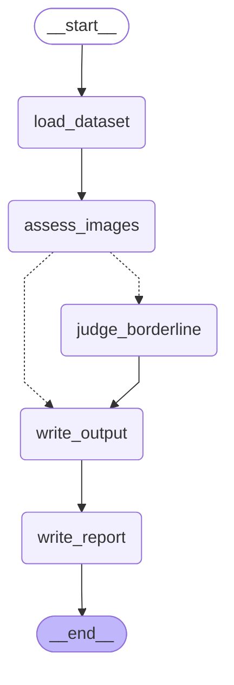

# cleanup

LangGraph pipeline that filters low-quality images out of a YOLO dataset before training
(RF-DETR / YOLO). Source data is never modified. Passing items are copied to a clean output dir.

```
load_dataset -> assess_images -> [judge_borderline] -> write_output -> write_report
```

- **assess_images**: deterministic checks (unreadable, resolution, exposure, blur via Laplacian
  variance, YOLO label validity).
- **judge_borderline**: only runs when some image is borderline (blur just above threshold).
  Pluggable `Judge`. Default applies `borderline_policy`. Optional free local VLM judge via
  Ollama (`--judge-model`). With `--judge-scope survivors` the VLM also reviews every image that
  passed the cheap checks.

## Dataset layout

```
data/raw/
  images/{train,val}/*.jpg
  labels/{train,val}/*.txt   # class cx cy w h (normalized)
```

## Usage

```bash
make install
make dry-run DATA=data/raw          # report only -> data/clean/report.json
make run DATA=data/raw OUT=data/clean
make stats
make check                          # lint + typecheck + tests
```

## VLM judge: Claude or local Ollama

`--judge-model` (and `cleanup gallery review --judge`) takes a spec:

- `claude:claude-opus-5-5`: Anthropic API, reads `ANTHROPIC_API_KEY` or an `ant auth login` profile
- `bedrock:claude-opus-5-5`: Claude on Amazon Bedrock. `claude-*` ids get Bedrock's `anthropic.`
  prefix; inference-profile ids (`us.anthropic...`) and ARNs are passed as is. Needs `AWS_REGION`
  plus either a Bedrock API key in `AWS_BEARER_TOKEN_BEDROCK`, or AWS credentials (`AWS_PROFILE`,
  keys, SSO) together with boto3 (`uv add 'anthropic[bedrock]'`). Bedrock bills at its own rates.
- `openai:<model>`: OpenAI chat models with vision, via langchain-openai (`uv add langchain-openai`).
  Reads `OPENAI_API_KEY`; `OPENAI_BASE_URL` points it at an OpenAI-compatible server. Uses strict
  JSON-schema output; effort/temperature are not sent, so the model's defaults apply.
- `ollama:qwen2.5vl:7b`: local Ollama

A provider prefix is required. Credentials can live in `.env`; it is exported to the
environment at start-up and overrides shell variables. Effort
(`CLEANUP_JUDGE_EFFORT=low|medium|high`, gallery: `--effort`) applies to Claude and Bedrock.

```bash
make run-vlm DATA=data/raw VLM=claude:claude-opus-5-5
```

### Local Ollama

```bash
brew install ollama
make ollama-serve                   # separate terminal
make ollama-pull VLM=qwen2.5vl:7b
make run-vlm DATA=data/raw SCOPE=survivors
```

VLM reasons land in `report.json` as `judge:keep|drop:<reason>`. If the model errors, the image
falls back to `borderline_policy` with reason `judge_error:<Exception>`.

Progress bars (tqdm) show per-stage progress with a live pass/fail tally; structlog prints a
summary per stage. `CLEANUP_LOG_LEVEL=DEBUG make run-vlm` also logs each judge decision.

Thresholds: see `src/cleanup/config.py`; override with `CLEANUP_*` env vars (`.env.example`).


## Gallery audit (`cleanup gallery`)

Audits the logo-identification gallery built by highfive-models' logo audit
(`analysis.parquet`, `summary.json`, `crops/`, `labels_with_pseudo/`). A fixed pipeline with a
VLM as judge, not an open-ended agent. Inputs are never modified; every run writes to
`<gallery>/agent_audit/<run>/` (or `--runs-dir`). Decisions are keyed by brand **name**.

| Step | Command | Output (in the run dir) |
|---|---|---|
| 1-3 | `init` | `crops.parquet` (subset), `flags.parquet`, `priority.csv`, `run.json` |
| 4 | `review` | `judgements.jsonl`, `units.jsonl`, `montages/`, `references.json`, `review_log.jsonl` |
| 5 | `resolve` | `decisions.parquet`, `brand_changes.csv`, `new_class_candidates.csv`, `summary.json` |
| 1 | `calibrate` | `calibration.json` (judge + flag precision vs your labels) |
| 8 | `ui` | labels and overrides appended to `events.jsonl` |

Typical loop:

```bash
G=--gallery-dir=../highfive-models/pre_processed/<audit dir>
T=--target-list=../highfive-models/highfive_models/data_processing/target_lists/target_logos_2024-11-25.txt

# 1. measuring stick: 300 stratified crops (1/3 suspects, 1/3 confusion pairs, 1/3 random)
uv run cleanup gallery init --run calib $G $T --calibration-sample 300
uv run cleanup gallery ui --run calib $G $T            # label them (keys 1-4), http://127.0.0.1:8765
uv run cleanup gallery review --run calib $G $T --judge claude:claude-haiku-5-5
uv run cleanup gallery review --run calib $G $T --judge claude:claude-opus-5-5
uv run cleanup gallery calibrate --run calib $G $T     # compare judges, tune flag thresholds

# 2. a real round, on a subset
uv run cleanup gallery init --run top20 $G $T --top-brands 20
uv run cleanup gallery review --run top20 $G $T --max-units 50   # budget cap; re-run to continue
uv run cleanup gallery resolve --run top20 $G $T --min-confidence medium
uv run cleanup gallery ui --run top20 $G $T            # before/after, override, Resolve button
```

**Subsets** (`init`): `--brands a,b`, `--top-brands N` (priority order), `--suspects-only`,
`--crop-ids file`, `--frac`, `--limit`, `--seed`, `--calibration-sample N`. `review` narrows
further with `--brands`, `--top-brands`, `--max-units`; it skips crops the same judge already
reviewed, so it is resumable and can be run in budget-sized slices. `--rejudge` reviews
in-scope crops again (e.g. after a prompt change); the newest verdict per crop wins.

**Deterministic flags** (`flags.parquet`, one bool column per flag). Hard flags remove a crop
from the gallery (`CLEANUP_GALLERY_HARD_FLAGS`); soft flags only inform review:

| Flag | Rule | Default |
|---|---|---|
| `small` | short side of the padded box < `min_side_px` | hard |
| `low_blur` | Laplacian variance at a fixed 128px scale < `blur_min` | hard |
| `empty` / `unreadable` | grey std < `empty_std` / file unreadable | hard |
| `duplicate` | same-class box with IoU >= `duplicate_iou` (original label kept) | hard |
| `out_of_bounds` | label box outside the image | hard |
| `conflicting_label` | same box, different class: one brand is wrong | soft |
| `extreme_aspect` | long/short side > `max_aspect` (wide wordmarks are real) | soft |
| `low_blur_rel` | blur below the brand's 5% quantile | soft |
| `low_contrast`, `too_dark`, `too_bright`, `missing_label` | | soft |

Each crop is also tagged with `origin`: `original` (human label), `pseudo` (older
pseudo-labeller) or `teacher` (distillation teacher, `teacher_run_prefix`), plus the teacher's
confidence.

**Review.** Crops are grouped per (brand, embedding cluster); noise crops (cluster -1) are grouped
by their kNN prediction. Each montage of up to 16 numbered crops, plus up to 4 reference crops
of the brand (one per video, editable in `references.json`), is sent as one image: a
REFERENCE section (not judged) above a REVIEW section. The judge returns per-crop verdicts
(`brand_match`, `different_brand`, `unrecognisable`, `not_a_logo`) with visible text, the brand
actually shown and a confidence. The system prompt holds the target list and is
prompt-cached. Hard-flagged crops are not sent (`--include-flagged` to override).

**Resolve.** Your label > hard flag > judge verdict > `pending`. A suggested brand on the target
list is a `relabel`; one that isn't is dropped from the gallery and listed in
`new_class_candidates.csv` for you to decide on. No class ids are invented.


